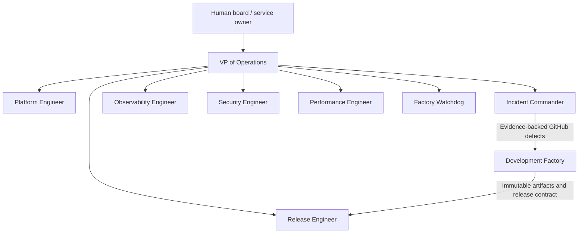

# Organization and ownership

## Reporting structure

The VP is accountable for results, but does not approve each routine operation.
During incidents, the Incident Commander coordinates the specialists. The
board remains the escalation authority for actions outside delegated limits.
Watchdog reports administratively to the VP and can escalate factory failure
directly to the board; it cannot repair, pause, or reconfigure its own subjects.

## Responsibilities

| Responsibility | Accountable agent | Supporting agents |
| --- | --- | --- |
| Service contract, priorities, exception ownership | VP of Operations | All specialists |
| Desired release and deployed artifact inventory | Release Engineer | Security, Incident Commander, Platform |
| Infrastructure and configuration desired state | Platform Engineer | Performance, Security |
| Incidents and customer-impact recovery | Incident Commander | All operational specialists |
| Metrics, logs, traces, probes, alert routing | Observability Engineer | Incident Commander, Performance |
| Security findings, test scope, containment guidance | Security Engineer | Platform, Release, Incident Commander |
| Performance qualification and capacity forecasts | Performance Engineer | Platform, Observability |
| Backup, restore, and stateful resource integrity, when applicable | Platform Engineer | Release, Incident Commander |
| Migration and rollback compatibility, when applicable | Release Engineer | Platform, Incident Commander |
| Factory queues, stuck runs, budget and telemetry health | Factory Watchdog | VP, independent monitors |
| Application defect tracking and acceptance | Incident Commander | Finding specialist, Release |

Each finding specialist owns evidence. Incident Commander owns the cross-factory defect
lifecycle and deduplication. A dedicated ticket-writing manager is unnecessary.
Infrastructure defects are normally repaired by Operations in its own IaC
repository; application defects are routed to Development. Unknown ownership
goes to the Incident Commander for triage rather than generating competing tickets.

## Continuous machinery versus agents

Health checks, telemetry ingestion, autoscaling, event delivery, deployment
controllers, policy checks, and emergency fallback run without LLM inference.
Paperclip coordinates durable tasks, ownership, scheduled reviews, and evidence.
The harness connects those tasks to tools and enforces the operating contract.

An external alert must have a deterministic path to recovery/on-call even if
Paperclip, the model provider, or its cloud environment is unavailable. Hosting
the only observer in the service's own failure domain is insufficient.

## Suggested first implementation

Define all roles now, but initially activate VP, Release, Platform, Incident Commander, and
Observability for one service. Add Security and applicable recovery assurance
before accepting production readiness. Performance can initially run on demand. Watchdog becomes
essential before unattended operation. Dedicated roles can share a model
runtime, but permissions and action ownership remain distinct.

Use event-driven wakes and bounded scheduled reviews. Do not wake every agent
every minute or create tasks simply to keep agents busy.
