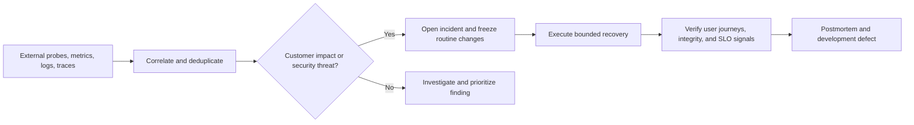

# Operational workflows

## Release reconciliation

1. Receive a registry/release event and periodically reconcile against the
   trusted release index to recover missed events. Authenticate events and
   deduplicate them using service, environment, release ID, and artifact digest.
2. Resolve the latest eligible release on the configured channel. Record
   desired, running, candidate, previous-known-good, and quarantined versions.
   Use immutable image digests, not the mutable `latest` tag.
3. Validate the release contract, publisher/provenance, security policy,
   configuration, dependencies, and database migration compatibility.
4. Acquire the service change lease. Recheck incident freeze, error budget,
   resource limits, target state, rollback viability, and release eligibility.
5. Apply required infrastructure/configuration through reviewed plans. Deploy
   to staging or a qualified isolated environment, then use the target's
   supported progressive rollout strategy. The strategy is still undecided.
6. Evaluate externally observed user journeys, error rates, latency, saturation,
   and integrity during the configured observation window. Compare with the
   baseline and absolute objectives; require adequate traffic/sample coverage.
7. Promote only when checks pass. Record digest, config/IaC revisions, schema
   state, evidence, and the observation window. Continue a post-release watch.
8. On regression, abort/roll back when safe, quarantine the candidate, and open
   a correlated incident/defect. Do not repeatedly retry a quarantined digest.
   A newer repaired release re-enters qualification; retrying the same digest
   requires explicit new evidence and an authorized quarantine decision.

Missing telemetry, insufficient samples, and unknown migration compatibility
hold a rollout rather than counting as success. Release lag is measured from
artifact eligibility; exceptions have owners and review/expiry dates. No
freshness deadline overrides an incident freeze or compatibility failure.

## Detection and incident recovery

1. Deterministic monitors alert on user impact, error-budget burn, and security
   indicators. Observability attaches recent changes and scoped telemetry.
   Correlate duplicate symptoms into one incident.
2. SRE declares severity, takes incident command, persists a timeline, freezes
   releases, and assigns operational work. SEV1 means widespread critical
   journey failure, significant data-integrity risk, or active compromise;
   SEV2 means material degradation or partial unavailability. Thresholds await
   the service contract.
3. Restore service with the simplest permitted runbook: rollback a compatible
   deployment/config, replace an unhealthy stateless workload, adjust capacity,
   or perform an explicitly delegated failover. Check dependencies first.
4. Apply one controlled change at a time unless a tested runbook requires an
   atomic group. Observe results between attempts. Respect retry, timeout,
   spending, data-loss, and customer-impact limits.
5. Verify recovery through external journeys and sustained health, not just
   a green deployment command. Record RTO and any measured data loss; missing
   measurements remain unknown. Preserve evidence with appropriate access.
6. Escalate immediately if recovery stalls or authority is insufficient.
   Notification uses the agreed channel; it must not wait for a GitHub issue.
7. After stabilization, investigate cause, create/update the Development defect,
   and document contributing factors and preventive work. Mark hypotheses as
   hypotheses. Recovery does not close a still-unfixed application defect.
8. Unfreeze changes after the stabilization criteria pass. Preserve the bad
   release's quarantine until there is a separate eligibility decision.

## Infrastructure lifecycle

Platform owns compute, networking, DNS/TLS, storage, queues, managed dependencies,
and configuration in the declared inventory. Plan changes, inspect replacement
and deletion effects, acquire leases, apply, verify, and persist IaC revisions.
Detect drift, certificate/secret expiry, quota pressure, and end-of-life risk.
Distinguish intentional incident mitigation from unauthorized drift.

## Investigation and feedback

Warnings and errors are investigation signals, not automatic outage declarations.
Compare new fingerprints, rates, affected tenants/journeys, deployment history,
and known benign patterns. Anomaly claims require a baseline and coverage note.

Each finding receives an owner, severity, supporting evidence, and disposition:
incident, operational repair, development defect, accepted risk, or false alarm.
SRE maintains one correlated Development ticket per defect fingerprint; reopened
regressions update/link prior work. Validate the eventual fix in the deployed
release before closing operational follow-up.
